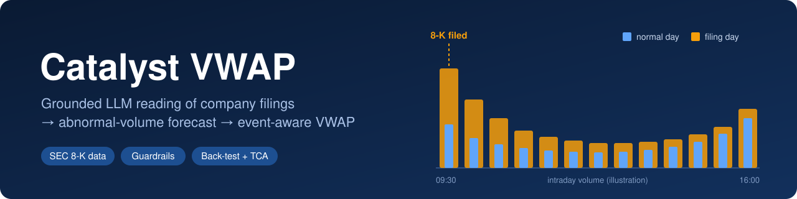
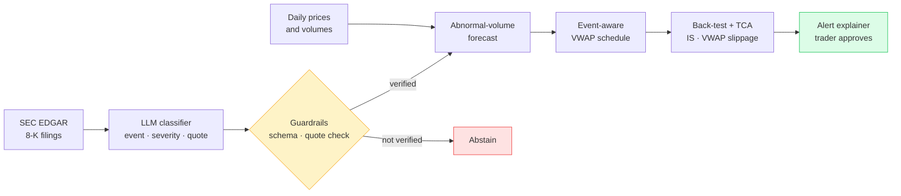

<div align="center">



### Can an LLM that *proves* what it read help an execution algorithm trade better on news days?


[The problem](#-the-problem) ·
[How it works](#-how-it-works) ·
[Guardrails](#-guardrails) ·
[Evaluation](#-how-it-will-be-evaluated) ·
[Roadmap](#-roadmap) ·
[References](#-references)

</div>

> [!NOTE]
> **Status (October 2026): the design is published, and the code is being built step by step.**
> No results are reported yet. Every result will be published here exactly as measured, including negative ones.

---

## 🎯 The problem

A **VWAP algorithm** splits a large order across the day so that it trades in step with the market's
*usual* volume pattern. That works on a normal day.

On days when a company publishes material news, such as earnings, a merger or a CEO departure, volume can
jump far above normal, and most of the jump often comes in the first minutes. A schedule built for a normal
day then trades at the wrong pace, and the client pays more.

| | Normal day | News day |
|---|---|---|
| Volume vs usual | about the same | often several times higher |
| When it trades | a U-shape over the day | heavy right after the news |
| Standard VWAP schedule | on track | too slow early, so it chases the price later |
| Today | the algorithm handles it | a trader has to read the news and step in |

US companies must report material events in a **Form 8-K** filing with the SEC. These filings are public,
timestamped and free. This project tests whether reading them automatically can help.

## ❓ The research question

> Does a fine-grained, **grounded** LLM classification of SEC 8-K filings predict **abnormal trading volume**
> better than the official 8-K item codes, and how much **execution cost** would a VWAP schedule save
> by using that prediction?

**What is new.** Dolphin et al. (2026) showed that grounded LLM event tags separate 8-K events that share an
item code, and they studied **price** reactions. They did not study **trading volume** or **execution cost**.
This project asks the execution desk's question: *does it change how we should trade?*

## 🧭 How it works



| Step | What happens | Key design choice |
|---|---|---|
| **1. Data** | 8-K filings (acceptance time, item codes, text) and daily prices and volumes for ~50 liquid US stocks, 2022 to today | SEC client with on-disk cache, declared User-Agent and a rate limit below the SEC's fair-access limit |
| **2. Event study** | Abnormal volume around filings, overall and by item code | `AV = log(V_t / median(V_{t-20..t-1}))`, built from past data only |
| **3. Grounded classification** | Each filing gets an event type, a severity and a **verbatim quote** as evidence | Checked against the public dataset released by Dolphin et al. and against a blind hand-labelled set |
| **4. Forecast** | 20-day baseline vs item codes vs LLM features | Strict time split: train ≤ 2024, test ≥ 2025 |
| **5. Execution back-test** | Standard VWAP vs event-aware VWAP, with a square-root market-impact model | The event-aware version changes the **shape** of the schedule (more weight early) and the **order size relative to expected volume**, not just a uniform scale |
| **6. Alert explainer** | Explains an alert to a trader | Uses only numbers from the data; it proposes, and a human approves |

### Timing rules that prevent look-ahead bias

- A filing accepted **after 16:00 New York time**, or on a non-trading day, counts for the **next** session.
- A filing accepted **before the open** can inform that day's schedule.
- A filing accepted **during the session** can only update the **remaining** part of the order
  (mid-order reforecasting). It never changes a forecast made before it existed.

## 🛡️ Guardrails

Built in from the start, not added at the end.

| Risk | Control |
|---|---|
| Malformed LLM output | Pydantic schema validation, up to 3 retries, then **abstain** |
| Hallucinated evidence | Every label needs a quote that matches the filing text (exact substring, or ≥ 40% of its 4-word sequences) |
| Instructions hidden in filing text | Filing text is treated as data, never as instructions; outputs are checked against the schema |
| Invented numbers in explanations | Every number the alert explainer shows is checked against the source data; if any number does not match, the explanation is not shown |
| Look-ahead bias | Timestamp rules above, plus tests that fail if a feature uses future data |
| Unreviewed decisions | The system only proposes; a human approves, and every decision is logged |
| Vendor lock-in | One provider-agnostic interface (Groq, Gemini, Mistral, local Ollama) |
| Secrets | API keys only from environment variables, never committed |

## 📏 How it will be evaluated

| Question | Metric | Compared against |
|---|---|---|
| Is the classifier reliable? | Accuracy, abstention rate, quote-verification failure rate | Blind hand labels and the Dolphin et al. public tags |
| Does it predict volume? | Out-of-sample error on abnormal volume (test period 2025 onwards) | 20-day median baseline and 8-K item codes |
| Does it lower trading cost? | Implementation shortfall and VWAP slippage (bps), residual at close | Standard VWAP schedule on the same event days |
| Is the result robust? | Sample sizes, confidence intervals, sensitivity to the impact parameter | Reported with every table |

## 🗺️ Roadmap

| Phase | Deliverable | Status |
|---|---|---|
| 0 | Design, guardrails and evaluation protocol | ✅ Published (this README) |
| 1 | Data pipeline: SEC client, 8-K table, daily prices, one rebuild command | ⏳ Next |
| 2 | Event study: abnormal volume around filings, by item code | ⬜ Planned |
| 3 | Grounded LLM classifier and its evaluation | ⬜ Planned |
| 4 | Volume forecast: baseline vs item codes vs LLM features | ⬜ Planned |
| 5 | Event-aware VWAP back-test and TCA | ⬜ Planned |
| 6 | Trader alert explainer with human approval | ⬜ Planned |
| ✚ | CI: linting and tests on every push | ⬜ Planned |

## 📊 Results

*Not available yet.* This section will hold the classifier evaluation, the forecast comparison and the
execution-cost table, with sample sizes and limitations, and it will report negative results too.

## ⚠️ Limitations (by design)

- Execution is **simulated** with a modelled intraday volume curve and an impact model. It is not replayed on a real order book.
- Free intraday history is short, so real intraday checks are limited to recent days.
- yfinance is an unofficial data source.
- Free LLM tiers limit how many filings can be classified.
- This is a research prototype. It is **not investment advice** and not a trading system.

## 🧰 Tech stack

`Python` · `pandas` · `pyarrow` · `httpx` · `pydantic` · `scikit-learn` · `LightGBM` · `matplotlib` · `pytest` · `ruff` · `GitHub Actions`

<details>
<summary><b>Planned project structure</b></summary>

```
src/catalyst/
├── data/        # SEC client, prices, event-time mapping
├── features/    # abnormal volume
├── llm/         # schema, guardrails, providers, classifier
├── models/      # volume forecast
├── execution/   # VWAP scheduler, impact model, TCA
└── cli.py
tests/
docs/            # learning notes and teaching guide
```

</details>

## 🗄️ Data sources

| Source | Use | Notes |
|---|---|---|
| [SEC EDGAR](https://www.sec.gov/os/accessing-edgar-data) | 8-K filings | Official and free; declared User-Agent; fair-access rate limit respected |
| [Dolphin et al. dataset](https://arxiv.org/abs/2607.08346) | Reference event tags | Public release accompanying the paper |
| [yfinance](https://github.com/ranaroussi/yfinance) | Daily prices and volumes | Unofficial source |
| Free LLM tiers | Classification | Public filings only; no private or client data |

## 📚 References

- Dolphin, R., Dursun, J., Blankenship, J., Adams, K., Pike, Q. (2026).
  *Grounded Event Extraction from SEC 8-K Filings with a Fine-Grained Taxonomy.*
  [arXiv:2607.08346](https://arxiv.org/abs/2607.08346)
- Cucuringu, M., Li, K., Zhang, C. (2025). *Forecasting Intraday Volume in Equity Markets with Machine Learning.*
  [arXiv:2505.08180](https://arxiv.org/abs/2505.08180)
- Zarinelli, E., Treccani, M., Farmer, J. D., Lillo, F. (2015). *Beyond the square root: Evidence for logarithmic
  dependence of market impact on size and participation rate.* [arXiv:1412.2152](https://arxiv.org/abs/1412.2152)

---

<div align="center">

**Anass El Alaoui** · AI Engineer<br/>
[LinkedIn](https://www.linkedin.com/in/anass-el-alaoui-b05316177/) · [GitHub](https://github.com/anass9elalaoui-netizen)

</div>
